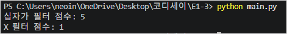
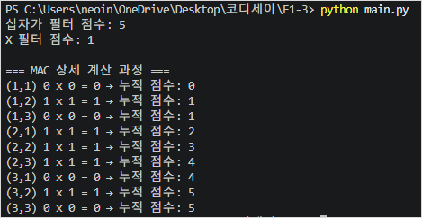
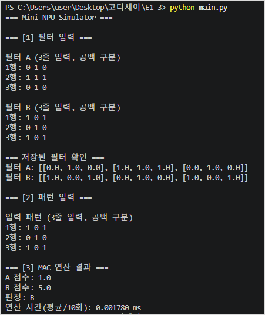
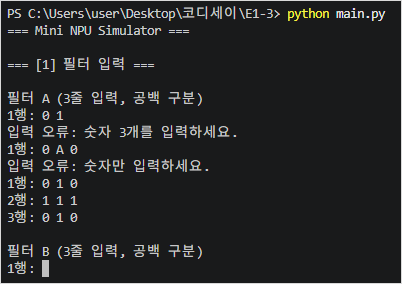
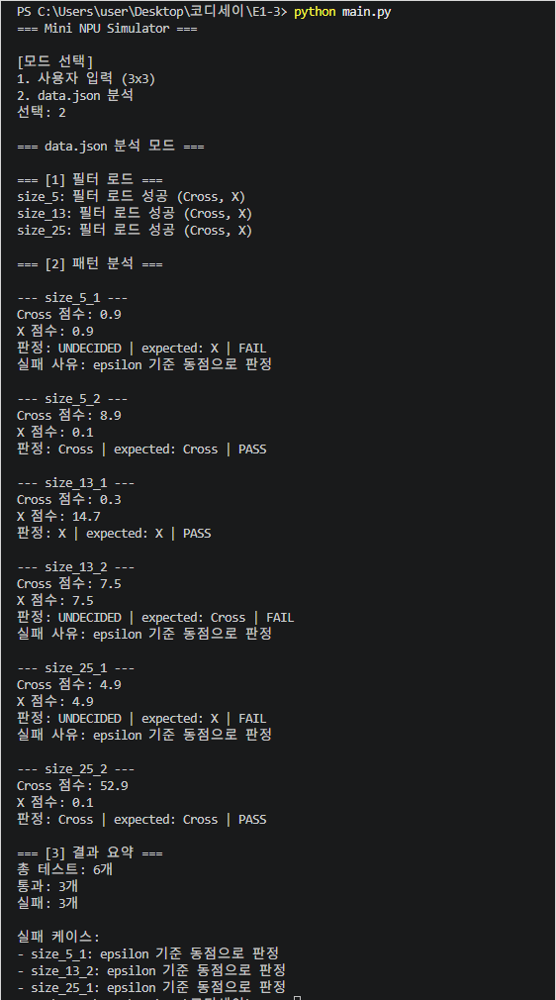
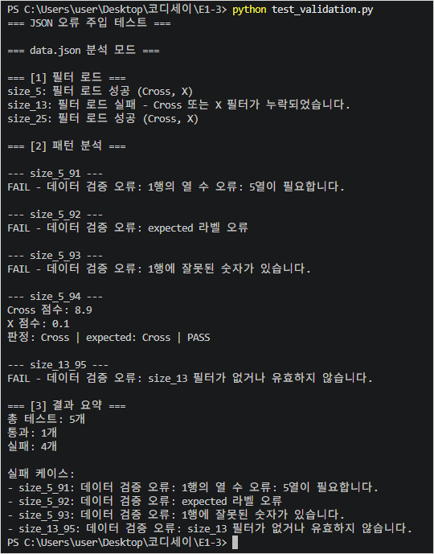
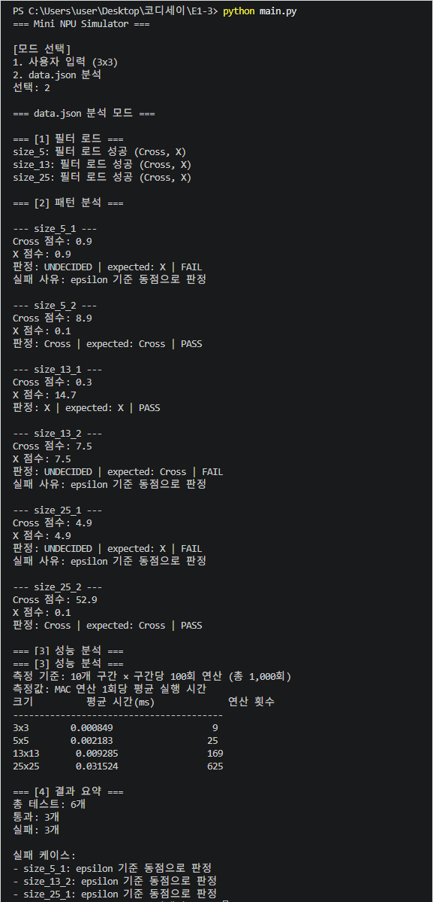
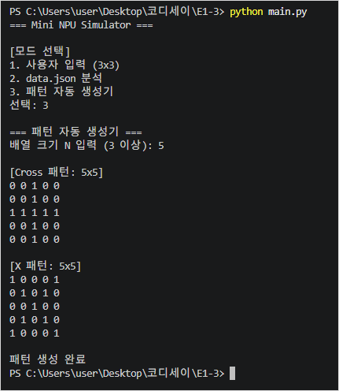
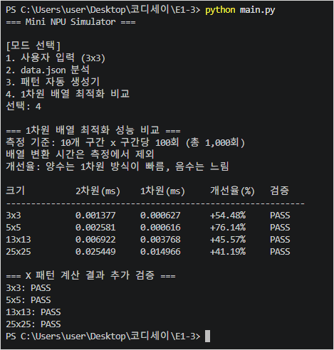
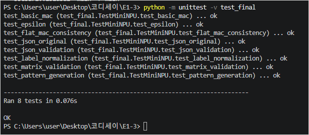

# Mini NPU Simulator

### AI의 핵심 연산인 MAC 구현 및 성능 분석

**Codyssey E1-3 | Python 개발 입문 과제**

## 1. 프로젝트 개요

### 1.1 개발 목적

인공지능은 이미지와 같은 정보를 수치 데이터로 변환하고, 다수의 곱셈과 덧셈을 반복하여 특징을 분석한다.

본 프로젝트에서는 AI 연산의 기초가 되는 MAC(Multiply-Accumulate) 연산을 Python으로 직접 구현하였다.

3×3부터 25×25까지의 숫자 배열을 활용하여 Cross(십자가)와 X 패턴을 판정하고, 배열 크기에 따른 연산 시간과 자료구조 변경에 따른 성능 차이를 분석하였다.

아울러 대규모 배열로 확장할 때 예상되는 시간·메모리 문제와 CPU·NPU의 처리 방식 차이를 검토하였다.

### 1.2 구현 범위

- 2차원 배열 기반 MAC 연산
- 3×3 필터와 패턴의 사용자 입력 및 오류 검증
- JSON 데이터 자동 분석 및 라벨 정규화
- 부동소수점 허용오차 기반 판정
- 모드별 판정 결과의 출력 및 집계 정책 구분
- 크기별 MAC 연산 시간 측정
- PASS/FAIL 판정 및 결과 요약
- Cross/X 패턴 자동 생성기
- 1차원 배열 변환 및 연산 성능 비교

본 프로그램은 AI 연산의 일부를 Python으로 모사하는 교육용 시뮬레이터이며, 실제 NPU 하드웨어를 구현하거나 병렬 연산을 수행하는 프로그램은 아니다.

## 2. 개발 환경 및 실행 방법

### 2.1 개발 환경

| 구분 | 내용 |
|---|---|
| 프로그래밍 언어 | Python 3.12 이상 |
| 개발 도구 | Visual Studio Code |
| 버전 관리 | Git / GitHub |
| 외부 라이브러리 | 사용하지 않음 |
| 표준 라이브러리 | json, re, math, time, pathlib, copy, unittest 등 |

### 2.2 프로젝트 파일 구성

| 파일 및 디렉터리 | 용도 |
|---|---|
| `main.py` | 시뮬레이터 메인 프로그램 |
| `data.json` | 과제 제공 필터 및 패턴 데이터 |
| `test_validation.py` | JSON 오류 검증용 테스트 |
| `data_validation.json` | 오류 주입 테스트 데이터 |
| `test_final.py` | 최종 자동 회귀 테스트 |
| `.gitignore` | Python 캐시 등 불필요한 파일의 Git 추적 제외 |
| `README.md` | 프로젝트 기술 보고서 |
| `docs/images/` | 개발 및 테스트 증빙 이미지 |

### 2.3 실행 방법

#### Python 및 Git 설치 (설치가 안 되어 있는 경우, 윈도우 환경 가정)

```bash
winget install -e --id Python.Python.3.14
winget install -e --id Git.Git
```

#### GitHub 저장소 복제

```bash
git clone https://github.com/neoinkyu/E1-3.git
cd E1-3
```

#### 프로그램 실행

```bash
python main.py
```

프로그램은 네 가지 실행 모드를 제공한다.

| 모드 | 기능 |
|---|---|
| 1 | 3×3 사용자 입력 및 MAC 판정 |
| 2 | data.json 자동 분석 및 성능 측정 |
| 3 | Cross/X 패턴 자동 생성 |
| 4 | 1차원 배열 최적화 비교 |

별도의 JSON 오류 검증은 다음 명령어로 실행한다.

```bash
python test_validation.py
```

최종 자동 회귀 테스트는 다음 명령어로 실행한다.

```bash
python -m unittest -v test_final
```

## 3. 프로그램 설계

### 3.1 주요 함수

| 함수 | 역할 |
|---|---|
| `mac()` | 2차원 배열 MAC 연산 |
| `mac_flat()` | 1차원 배열 MAC 연산 |
| `input_matrix()` | 3×3 사용자 입력 및 검증 |
| `classify()` | 두 MAC 점수 비교 및 공통 판정 |
| `normalize_label()` | 라벨 정규화 |
| `validate_matrix()` | JSON 배열 구조 및 값 검증 |
| `load_filters()` | 크기별 필터 로드 및 검증 |
| `json_mode()` | JSON 일괄 분석 |
| `benchmark_mac()` | MAC 연산 평균 실행 시간 측정 |
| `performance_analysis()` | 크기별 성능 분석 |
| `generate_pattern()` | Cross/X 패턴 자동 생성 |
| `flatten_matrix()` | 2차원 배열을 1차원 배열로 변환 |
| `optimization_mode()` | 최적화 전후 성능 비교 |

기능별로 함수를 분리하고, 사용자 입력 모드와 JSON 분석 모드가 동일한 MAC 연산 및 판정 함수를 사용하도록 구성하였다.

이를 통해 중복 코드를 줄이고 계산 정책의 일관성을 유지하였다.

### 3.2 모드별 판정 정책 및 출력 설계

프로그램의 두 주요 모드는 동일한 MAC 연산과 허용오차 정책을 사용하지만, 사용자에게 표시하는 판정 결과와 집계 방식은 다르다.

공통 판정 함수 `classify()`는 두 점수를 비교하여 `A`, `B`, `UNDECIDED` 중 하나를 반환한다.

각 모드는 반환값을 목적에 맞게 변환하여 출력한다.

| 구분 | 모드 1: 사용자 입력 | 모드 2: JSON 분석 |
|---|---|---|
| 비교 대상 | 필터 A와 B | Cross와 X 필터 |
| 동점 기준 | 점수 차이 < 1e-9 | 점수 차이 < 1e-9 |
| 동점 내부값 | UNDECIDED | UNDECIDED |
| 동점 화면 출력 | 판정 불가 | UNDECIDED |
| 비동점 화면 출력 | A 또는 B | Cross 또는 X |
| 기대값 비교 | 없음 | expected와 비교 |
| PASS/FAIL 집계 | 수행하지 않음 | 케이스별 수행 |

**모드 1**은 사용자가 직접 입력한 두 필터를 비교하는 기능이다. 두 점수가 동점이면 내부 반환값인 `UNDECIDED`를 화면에 `판정 불가`로 변환하여 출력한다. 기대 라벨이 없으므로 PASS/FAIL을 집계하지 않는다.

**모드 2**는 JSON 데이터의 정답 라벨과 예측 결과를 비교하는 자동 검증 기능이다. 내부 판정 결과가 A이면 Cross, B이면 X로 변환하며, 동점인 경우에는 `UNDECIDED`를 그대로 출력한다.

모드 2에서 예상 정답이 Cross 또는 X인데 판정이 UNDECIDED라면 FAIL로 집계하고, 동점 규칙에 따른 실패 사유를 남긴다.

두 모드는 **동일한 계산·동점 판정 기준을 사용하고, 최종 표시 형식과 집계 방식만 달리하도록 설계**하였다. 이러한 분리는 공통 계산 로직을 유지하면서도 사용자 입력과 자동 평가의 목적 차이를 반영하기 위한 것이다.

## 4. MAC 연산 구현

### 4.1 MAC 연산 원리

MAC(Multiply-Accumulate)은 두 배열의 같은 위치에 있는 숫자를 곱한 후, 각 곱셈 결과를 모두 누적하여 더하는 연산이다.

N×N 배열의 MAC 점수는 다음과 같이 계산한다.

**MAC = Σ(입력 패턴의 각 원소 × 필터의 같은 위치 원소)**

3×3 배열에서는 9회의 곱셈이 이루어진다.

십자가 패턴을 이용한 기본 테스트 결과는 다음과 같다.

- Cross 필터 점수: 5
- X 필터 점수: 1
- 판정: Cross



### 4.2 상세 계산 과정 검증

MAC 함수에 상세 출력 기능을 추가하여 각 위치의 곱셈과 누적 점수를 확인하였다.

3×3 패턴을 적용한 결과 총 9회의 곱셈이 실행되었으며, 최종 누적 점수는 5점이었다.

이 과정에서 중첩 `for`문의 동작과 `score += product`를 이용한 누적 덧셈의 원리를 확인하였다.



## 5. 사용자 입력 모드 구현

### 5.1 입력 및 판정

사용자가 필터 A, 필터 B 및 입력 패턴을 직접 입력하도록 구현하였다.

각 배열은 3×3 크기이며, 숫자를 공백으로 구분하여 한 줄씩 입력한다.

X 패턴을 입력한 테스트 결과는 다음과 같다.

| 항목 | 결과 |
|---|---|
| 필터 A | Cross |
| 필터 B | X |
| A 점수 | 1.0 |
| B 점수 | 5.0 |
| 최종 판정 | B |

입력값은 실수(float)로 변환하여 정수와 소수 모두 처리할 수 있도록 하였다.



### 5.2 입력 오류 검증

입력 과정에서 다음 항목을 검증하였다.

- 한 행에 입력한 숫자의 개수가 3개인지 확인
- 숫자로 변환할 수 없는 값이 포함되었는지 확인
- NaN 또는 무한대처럼 유한하지 않은 값인지 확인
- 오류 발생 시 안내 메시지를 표시하고 해당 행을 다시 입력받도록 처리

잘못된 입력으로 인해 프로그램이 비정상 종료되지 않고 정상적인 값을 다시 입력받는 것을 확인하였다.



### 5.3 동점 판정 및 출력 처리

사용자 입력 모드에서도 JSON 분석 모드와 동일하게 `epsilon = 1e-9` 기준을 적용한다.

예를 들어 두 필터의 점수가 각각 0.9와 0.8999999999999999라면, 점수 차이가 허용오차 미만이므로 동점으로 간주한다.

이때 공통 판정 함수는 `UNDECIDED`를 반환하지만, 사용자 입력 모드에서는 이를 `판정 불가`라는 한글 메시지로 변환하여 표시한다.

```text
A 점수: 0.9
B 점수: 0.8999999999999999
판정: 판정 불가
```

이는 실수 비교 정책을 변경한 것이 아니라, 사용자가 이해하기 쉬운 형태로 출력 문자열만 변경한 것이다.

사용자 입력 모드에는 기대 정답이 없으므로 동점 여부와 관계없이 PASS/FAIL 집계를 수행하지 않는다.

## 6. JSON 데이터 자동 분석

### 6.1 데이터 구조 및 라벨 정규화

과제에서 제공한 `data.json`은 필터 정보와 패턴 정보로 구성된다.

필터는 `size_5`, `size_13`, `size_25` 키로 구분되며, 각 크기에 Cross와 X 필터가 포함되어 있다.

패턴은 `size_N_idx` 형식의 키를 사용하며, `input`과 `expected` 값을 포함한다.

프로그램은 패턴 키에서 N을 추출하여 대응하는 필터를 선택한다.

JSON에 사용된 라벨은 다음 기준에 따라 표준화한다.

| 원본 라벨 | 표준 라벨 |
|---|---|
| `+` | Cross |
| `cross` | Cross |
| `x` | X |

라벨 정규화를 통해 필터 키와 기대값의 표현 차이로 인한 잘못된 FAIL 판정을 방지하였다.

### 6.2 MAC 점수 및 동점 판정 정책

각 패턴에 대해 Cross와 X 필터의 MAC 점수를 계산하고, 더 높은 점수를 얻은 필터를 판정 결과로 사용한다.

단, 부동소수점 연산의 미세한 오차를 고려하여 다음 비교 정책을 적용한다.

**|Cross 점수 - X 점수| < 1e-9 → UNDECIDED**

두 점수의 차이가 허용오차 미만이라면 동점으로 판정한다.

이는 거의 동일한 점수의 미세한 수치 차이 때문에 판정이 달라지는 문제를 방지하기 위한 것이다.

JSON 분석 모드의 판정 결과는 Cross, X, UNDECIDED 중 하나이며, 기대값인 `expected`와 비교하여 PASS/FAIL을 결정한다.

- 판정과 기대값이 같으면 PASS
- 서로 다르면 FAIL
- 동점(UNDECIDED)으로 판정되었으나 기대값이 Cross 또는 X이면 FAIL

동점에 따른 FAIL은 계산 함수의 오류가 아니라, 판정 정책과 기대 라벨의 불일치로 구분하여 기록한다.

### 6.3 JSON 자동 분석 결과

원본 `data.json`의 총 6개 패턴을 분석한 결과는 다음과 같다.

| 케이스 | Cross 점수 | X 점수 | 판정 | 결과 |
|---|---:|---:|---|---|
| size_5_1 | 0.9 | 0.9 | UNDECIDED | FAIL |
| size_5_2 | 8.9 | 0.1 | Cross | PASS |
| size_13_1 | 0.3 | 14.7 | X | PASS |
| size_13_2 | 7.5 | 7.5 | UNDECIDED | FAIL |
| size_25_1 | 4.9 | 4.9 | UNDECIDED | FAIL |
| size_25_2 | 52.9 | 0.1 | Cross | PASS |

**분석 결과: 전체 6개 / PASS 3개 / FAIL 3개**

세 개의 FAIL은 동점 판정과 기대 라벨의 불일치에 따른 결과이다.



### 6.4 JSON 오류 처리 검증

원본 JSON을 변경하지 않고 별도의 시험 데이터를 생성하여 오류 처리 기능을 검증하였다.

| 테스트 | 오류 유형 | 결과 |
|---|---|---|
| size_5_91 | 배열 열 개수 불일치 | FAIL |
| size_5_92 | 잘못된 expected 라벨 | FAIL |
| size_5_93 | 숫자 대신 문자열 입력 | FAIL |
| size_5_94 | 정상 데이터 | PASS |
| size_13_95 | X 필터 누락 | FAIL |

**오류 검증 결과: 전체 5개 / PASS 1개 / FAIL 4개**

프로그램은 잘못된 데이터에 대해 오류 원인을 출력하고 다음 테스트를 계속 수행하였다.

따라서 개별 데이터 오류가 전체 프로그램의 실행 중단으로 이어지지 않음을 확인하였다.



## 7. MAC 연산 성능 분석

### 7.1 측정 방법

Python의 `time.perf_counter_ns()`를 사용하여 MAC 함수의 실행 시간을 측정하였다.

측정 조건은 다음과 같다.

- 10개 측정 구간 사용
- 구간마다 MAC 함수 100회 호출
- 총 1,000회 연산 결과를 평균
- 측정 전 10회 예비 실행
- 파일 읽기 및 콘솔 출력 시간 제외
- 연산 함수 1회당 평균 실행 시간을 ms로 표시

### 7.2 배열 크기별 성능 측정 결과

6단계에서 수행한 초기 성능 측정 결과는 다음과 같다.

| 배열 크기 | MAC 곱셈 횟수 | 평균 실행 시간(ms) |
|---|---:|---:|
| 3×3 | 9 | 0.000694 |
| 5×5 | 25 | 0.001524 |
| 13×13 | 169 | 0.008820 |
| 25×25 | 625 | 0.030114 |

*위 값은 당시의 1.0으로 구성한 고정 시험 배열을 이용한 실측 결과이다. 이후 패턴 생성 기능을 연동한 버전에서는 Cross 패턴을 사용하므로 측정 조건과 결과가 달라질 수 있다.*



### 7.3 시간 복잡도 분석

MAC 연산은 N×N 배열의 모든 위치에 접근하여 곱셈과 덧셈을 수행한다.

외부 반복문은 N회, 내부 반복문은 N회 실행되므로 전체 원소 처리 횟수는 N²이다.

따라서 기본 MAC 함수의 시간 복잡도는 **O(N²)**이다.

3×3 배열은 9개의 원소를 처리하지만, 25×25 배열은 625개를 처리한다.

즉, 25×25 배열은 3×3보다 약 69.4배 많은 원소를 계산한다.

실제 측정에서도 배열 크기가 증가할수록 평균 실행 시간이 증가하는 경향을 확인하였다.

다만 함수 호출 비용, Python 반복문 오버헤드, 시스템 부하 및 측정 오차의 영향으로 실행 시간이 곱셈 횟수에 정확히 비례하지는 않는다.

이번 실험은 O(N²)의 이론적 구조와 부합하는 성능 증가 경향을 확인한 것이며, 측정 결과만으로 시간 복잡도를 수학적으로 증명한 것은 아니다.

### 7.4 대규모 배열 처리 시 시간·메모리 위험과 최적화 방안

현재 시뮬레이터의 성능 분석 범위는 최대 25×25 배열이다. 이를 1000×1000 이상의 배열로 확장할 경우 다음과 같은 문제가 예상된다.

#### ① 연산 시간 증가

1000×1000 배열은 원소가 1,000,000개이므로 필터 하나를 적용할 때 100만 회의 곱셈과 누적 덧셈이 필요하다.

Cross와 X 필터를 각각 적용하면 하나의 패턴을 판정하는 데 약 200만 회의 MAC 원소 연산이 수행된다.

이는 25×25 필터 하나의 625회 연산과 비교하여 필터당 연산 횟수가 1,600배 증가한 것이다.

특히 Python의 반복문을 이용한 직렬 연산에서는 모든 원소를 순서대로 처리하므로 입력 크기 증가에 따라 처리 시간이 크게 늘어날 수 있다.

현재 성능 분석 방식인 1,000회 반복 측정을 그대로 적용하면 1000×1000 배열에서는 필터당 총 10억 회의 원소 연산이 이루어진다.

따라서 대규모 데이터에서는 측정 반복 횟수를 별도로 조정할 필요가 있다.

#### ② 메모리 사용량 증가

현재 프로그램은 2차원 배열을 Python 리스트로 저장한다.

1000×1000 배열 하나에는 100만 개의 원소가 필요하며, 입력 패턴과 두 개의 필터를 함께 보관하면 총 300만 개의 원소 위치가 필요하다.

64비트 Python 환경에서 리스트 원소 참조만 단순 계산하면 100만 개당 약 8MB가 필요하다. 그러나 실제로는 행별 리스트, 숫자 객체, JSON 파싱 결과 등 추가 메모리가 사용되므로 전체 사용량은 더 커진다.

특히 1차원 배열 최적화 과정에서 원본 2차원 배열과 변환된 1차원 배열을 동시에 보관하면 추가 메모리가 발생한다.

대규모 JSON 파일을 한 번에 읽어 메모리에 적재하는 구조 역시 메모리 부족이나 처리 지연의 원인이 될 수 있다.

#### ③ 입력·출력 병목

1000×1000 크기의 배열을 콘솔에 직접 출력하면 100만 개의 숫자를 화면에 표시해야 한다.

이때 실제 MAC 계산보다 문자열 변환과 콘솔 출력에 더 많은 시간이 소요될 수 있다.

따라서 대규모 패턴 생성 기능은 배열 전체가 아니라 크기, 주요 특징 및 일부 행만 출력하도록 변경하는 것이 적절하다.

#### ④ 최적화 우선순위

| 우선순위 | 개선 항목 | 목적 |
|---|---|---|
| 1 | 배열 크기 제한 및 사전 검증 | 과도한 메모리 사용과 비정상 입력 방지 |
| 2 | 불필요한 배열 복사·중복 저장 최소화 | 메모리 사용량 감소 |
| 3 | 대규모 데이터의 분할 처리 및 출력량 제한 | 메모리·I/O 부담 완화 |
| 4 | 입력 크기에 따른 성능 측정 반복 횟수 조정 | 과도한 벤치마크 실행 시간 방지 |
| 5 | 1차원 배열 접근 및 반복문 최적화 | MAC 함수 실행 시간 개선 |
| 6 | 병렬 처리 및 전용 연산 장치 도입 검토 | 대규모 반복 연산의 처리량 향상 |

우선적으로 적용할 개선은 **입력 크기 제한, 메모리 중복 사용 최소화, 대규모 데이터의 분할 처리**이다.

그다음 실제 실행 시간과 메모리 사용량을 측정하여 병목 구간을 확인하고, 연산 구조의 최적화 여부를 판단하는 것이 합리적이다.

현재 프로그램에는 이러한 대규모 데이터용 보호·분할 처리 기능이 모두 구현되어 있지는 않다. 본 절은 1000×1000 이상으로 확장하는 경우의 예상 위험과 향후 개선 우선순위를 분석한 것이다.

### 7.5 CPU 직렬 처리와 NPU 병렬 처리의 병목 및 확장성 분석

#### ① CPU 기반 MAC 연산의 특성

현재 프로그램은 Python의 반복문을 이용하여 MAC 연산을 순차적으로 수행한다.

각 원소에 대해 곱셈과 누적 덧셈을 실행하고 다음 위치로 이동하는 방식이다.

실제 CPU는 여러 코어와 벡터 연산 기능을 제공하지만, 현재 구현은 이러한 기능을 직접 활용하는 병렬·벡터화 코드가 아니다.

따라서 본 시뮬레이터의 주요 병목은 다음과 같다.

- Python 반복문 및 인덱스 접근에 따른 실행 오버헤드
- 입력 배열과 필터에 대한 반복적인 메모리 접근
- 배열 크기 증가에 따른 캐시 효율 저하 가능성
- 순차적 누적 계산으로 인한 실행 시간 증가

작은 배열에서는 함수 호출이나 반복문 오버헤드의 영향이 상대적으로 크지만, 대규모 배열에서는 원소 처리량과 메모리 접근 비용의 중요성이 증가한다.

#### ② NPU 기반 병렬 처리의 특성

NPU(Neural Processing Unit)는 신경망 연산에 필요한 대량의 곱셈·누적 연산을 효율적으로 수행하도록 설계된 전용 처리 장치이다.

다수의 연산 유닛을 활용하여 서로 독립적인 계산을 동시에 처리하고, 연산 과정에서 데이터 재사용을 높이도록 설계할 수 있다.

따라서 MAC 연산이 대량으로 반복되는 환경에서는 CPU의 순차적 Python 구현보다 높은 처리량을 기대할 수 있다.

다만 연산을 병렬화하더라도 전체 계산량이 없어지는 것은 아니며, 실제 처리 속도는 병렬 연산 자원의 수, 데이터 이동량, 메모리 대역폭, 연산 장치 활용률 등에 영향을 받는다.

#### ③ CPU와 NPU의 스케일링 및 병목 비교

| 비교 항목 | 현재 CPU 기반 구현 | NPU 기반 병렬 가속 |
|---|---|---|
| 처리 구조 | Python 반복문을 이용한 순차 처리 | 다수 연산 유닛을 활용한 병렬 처리 |
| 계산량 | N²개 원소 처리 | 동일한 계산을 병렬 분산 가능 |
| 주요 병목 | 반복문 오버헤드, 인덱스·메모리 접근 | 메모리 대역폭, 데이터 이동, 연산 유닛 활용률 |
| 배열 크기 증가 | 실행 시간 증가 | 병렬 자원 활용에 따라 증가 폭 완화 가능 |
| 소규모 배열 | 구현이 단순하고 추가 전송 비용이 없음 | 초기화·데이터 전송 비용이 상대적으로 클 수 있음 |
| 대규모 배열 | 직렬 처리 시간이 크게 증가할 수 있음 | 충분한 병렬성과 데이터 재사용이 있으면 유리 |
| 본 프로젝트 검증 | 직접 구현 및 실행 시간 측정 | 이론적 비교, 실제 측정 미수행 |

#### ④ 대규모 MAC 연산의 대응 방안

대규모 MAC 연산을 효율적으로 처리하려면 계산 방식뿐 아니라 데이터 이동 방식도 함께 개선해야 한다.

우선 CPU 환경에서는 반복문과 자료구조의 불필요한 오버헤드를 줄이고, 메모리 접근 방식과 데이터 재사용 가능성을 검토해야 한다.

이후 병렬 연산 장치를 활용할 수 있는 환경에서는 독립적인 연산을 여러 연산 유닛에 분배하고, 데이터 이동을 최소화하는 방향으로 설계할 수 있다.

특히 NPU의 성능은 단순히 연산 유닛의 수만으로 결정되지 않는다. 필요한 데이터를 충분히 빠르게 공급하지 못하면 병렬 연산 유닛이 대기하면서 메모리 병목이 발생할 수 있다.

반대로 연산 규모가 작으면 데이터 전송이나 실행 준비에 드는 비용 때문에 병렬 처리의 이점이 크지 않을 수도 있다.

따라서 실제 가속 장치 도입 여부는 **연산량, 병렬화 가능한 작업의 비율, 데이터 이동 비용, 메모리 사용량을 종합적으로 고려**하여 결정해야 한다.

본 프로젝트에서는 외부 연산 라이브러리를 사용하지 않는 과제 조건에 따라 CPU 기반 Python 반복문으로 MAC 연산을 구현하였다.

NPU를 이용한 실제 병렬 처리 속도는 측정하지 않았으며, 본 절은 현재 구현의 한계와 대규모 연산으로 확장할 때 고려해야 할 설계 요소를 분석한 것이다.

## 8. 보너스 과제

### 8.1 Cross/X 패턴 자동 생성

사용자가 배열 크기 N을 입력하면 N×N 크기의 Cross 및 X 패턴을 자동으로 생성하도록 구현하였다.

Cross 패턴은 중앙 행과 열에 1을 배치하며, X 패턴은 양쪽 대각선에 1을 배치한다.

짝수 크기에서는 Cross의 중앙 두 행과 두 열을 사용하도록 처리하였다.

생성한 패턴은 사용자 입력 모드와 성능 측정에도 재활용하였다.



### 8.2 1차원 배열 최적화

기존의 2차원 배열을 길이 N²의 1차원 리스트로 변환하여 접근 구조를 단순화하였다.

2차원 방식은 중첩 반복문을 사용하지만, 1차원 방식은 단일 반복문으로 모든 원소에 접근한다.

동일한 데이터와 반복 횟수를 사용하여 최적화 전후 성능을 비교하였다.

| 크기 | 2차원(ms) | 1차원(ms) | 실행 시간 감소율 |
|---|---:|---:|---:|
| 3×3 | 0.001372 | 0.000613 | 55.30% |
| 5×5 | 0.002438 | 0.000571 | 76.58% |
| 13×13 | 0.007852 | 0.003559 | 54.67% |
| 25×25 | 0.025669 | 0.014507 | 43.49% |

이번 측정에서는 모든 크기에서 1차원 방식의 MAC 함수 실행 시간이 더 짧았다.

Cross 및 X 패턴을 대상으로 원래 MAC 함수와 최적화 MAC 함수의 계산 결과를 비교한 결과, 8개 정확성 검증이 모두 PASS였다.

그러나 배열을 1차원으로 변환하는 시간은 측정에 포함하지 않았다.

따라서 위 결과는 순수 MAC 함수의 실행 시간 감소율이며, 전체 프로그램의 처리 시간 개선율은 아니다.

또한 짧은 연산에서는 측정 환경에 따라 결과가 변동될 수 있다. 예를 들어 이번 측정에서 5×5의 1차원 실행 시간이 3×3보다 짧게 나타난 것은 측정 변동의 영향을 받은 것으로 해석할 수 있다.

1차원 방식 역시 N²개의 원소를 방문하므로 시간 복잡도는 **O(N²)**으로 동일하다.



## 9. 결과 리포트

### 9.1 전체 검증 결과

| 검증 항목 | 결과 |
|---|---|
| 3×3 기본 MAC 연산 | 정상 |
| 사용자 입력 및 오류 처리 | 정상 |
| JSON 원본 데이터 분석 | PASS 3 / FAIL 3 |
| JSON 오류 주입 검증 | PASS 1 / FAIL 4 |
| 크기별 성능 분석 | 정상 |
| 패턴 자동 생성 | 정상 |
| 1차원·2차원 계산 결과 비교 | 8개 검증 PASS |
| 최종 자동 회귀 테스트 | 8개 PASS |



위 PASS/FAIL 집계는 각 시험의 목적이 다르므로 하나의 정확도 지표로 합산하지 않았다.

### 9.2 FAIL 원인 분석

**① 데이터 및 스키마 문제**

배열의 행과 열 개수가 일치하지 않거나, 숫자가 아닌 문자열이 포함된 경우 MAC 연산을 안전하게 수행할 수 없다.

이를 해결하기 위해 배열 크기, 행별 열 개수, 숫자 자료형과 유한성을 검증하였다.

잘못된 데이터가 발견되면 해당 케이스를 FAIL로 기록하고 오류 원인을 출력하도록 구성하였다.

**② 라벨 불일치 문제**

과제 데이터에서는 Cross를 `+` 또는 `cross`로 표현하고, X는 `x`로 표현한다.

이 문자열을 그대로 비교하면 같은 의미의 라벨도 서로 다른 값으로 처리될 수 있다.

따라서 내부 표준 라벨을 Cross와 X로 통일하여 비교하도록 개선하였다.

**③ 부동소수점 비교 문제**

실수 연산에서는 0.9와 0.8999999999999999처럼 계산 결과에 미세한 차이가 발생할 수 있다.

단순한 대소 비교만 사용하면 이러한 차이로 인해 잘못된 우열 판정이 발생할 수 있다.

이를 방지하기 위해 점수 차이가 `1e-9` 미만이면 동점으로 처리하는 허용오차 정책을 적용하였다.

**④ 동점에 따른 FAIL**

원본 데이터의 `size_5_1`, `size_13_2`, `size_25_1`은 두 필터의 MAC 점수가 동점으로 판정된 케이스이다.

프로그램은 명시된 비교 정책에 따라 UNDECIDED를 반환하였지만, 기대 라벨은 Cross 또는 X로 지정되어 있다.

따라서 세 케이스를 FAIL로 집계하는 것이 현재 정책에 부합한다.

이는 프로그램의 계산 오류를 의미하지 않으며, 점수 비교 정책과 기대 라벨 사이의 불일치를 보여준다.

**⑤ 로직 문제와 데이터 문제의 구분**

검증 과정에서는 먼저 데이터의 구조와 라벨이 유효한지 확인하고, 그다음 MAC 연산 결과를 검토하도록 구성하였다.

계산 과정이 잘못된 경우와 입력 데이터가 잘못된 경우를 구분하는 것이 오류 분석에 중요하다.

실제 제공 데이터에서 발생한 3개 FAIL은 확인된 계산 로직 오류가 아니라 동점 처리 정책에 따른 결과이다.

**⑥ 모드별 판정 정책의 구분**

모드 1과 모드 2는 모두 공통 판정 함수를 사용하지만, 출력 문자열과 집계 방식이 다르다.

모드 1은 동점 결과를 사용자에게 `판정 불가`로 표시하며, 기대 정답이 없으므로 PASS/FAIL 집계를 하지 않는다.

모드 2는 동점 결과를 `UNDECIDED`로 표시하고, expected와 비교하여 PASS/FAIL을 집계한다.

이를 통해 공통 수치 비교 정책을 유지하면서 모드별 결과 처리의 목적과 차이를 명확히 하였다.

### 9.3 성능 및 복잡도 종합 분석

N×N MAC 연산은 입력 크기에 따라 N²개의 곱셈을 수행하므로 O(N²)의 시간 복잡도를 가진다.

반복문을 사용한 2차원 방식과 1차원 방식은 모두 같은 수의 원소를 처리한다.

1차원 배열은 행·열 접근을 단일 인덱스 접근으로 단순화하여 이번 실험에서 실행 시간을 줄였다.

그러나 원소 처리 횟수 자체를 감소시키지는 않으므로 점근적 시간 복잡도는 변하지 않는다.

또한 2차원 배열을 1차원 배열로 변환하는 작업 자체도 O(N²)의 시간이 소요되며, 별도 리스트를 생성하기 위한 O(N²)의 추가 공간이 필요하다.

따라서 최적화 효과를 평가할 때에는 계산 함수의 실행 시간뿐 아니라 데이터 변환 비용과 실행 환경도 함께 고려해야 한다.

1000×1000 이상의 배열을 처리하는 경우에는 연산량 증가뿐 아니라 Python 리스트의 메모리 사용량, 데이터 복사, JSON 파싱, 콘솔 출력 등의 병목도 중요해진다.

따라서 우선적으로 입력 크기 제한과 메모리 사용 개선을 검토하고, 이후 성능 측정을 통해 반복문 최적화 및 병렬 처리 도입의 필요성을 판단하는 것이 적절하다.

CPU 기반 직렬 구현은 구조가 단순하지만 대량의 반복 계산에서 실행 시간이 증가할 수 있다.

반면 NPU와 같은 전용 병렬 처리 장치는 다수의 MAC 연산을 동시에 수행할 수 있으나, 데이터 전송과 메모리 대역폭의 제약을 함께 고려해야 한다.

현재 프로젝트에서는 CPU 기반 실행 시간만 측정하였으며, 대규모 처리 및 NPU 가속 효과는 향후 확장 방향으로 분석하였다.

## 10. 결론

본 과제를 통해 AI 연산의 기초가 되는 MAC 연산을 직접 구현하고, 다양한 크기의 패턴을 수치적으로 비교하는 원리를 학습하였다.

특히 단순한 계산 기능에서 출발하여 사용자 입력 검증, JSON 데이터 분석, 라벨 정규화, 부동소수점 비교 및 성능 측정으로 기능을 확장하였다.

오류 데이터를 이용한 시험에서는 입력 데이터 문제와 연산 결과의 정책적 불일치를 구분하여 분석하는 경험을 얻었다.

또한 1차원 배열 최적화 실험을 통해 자료구조와 반복문 구조가 실제 실행 시간에 영향을 미칠 수 있음을 확인하였다.

대규모 배열 처리에 대한 분석에서는 계산량 증가뿐 아니라 메모리 사용, 데이터 이동, 입출력 병목과 같은 문제를 고려해야 함을 확인하였다.

CPU의 순차적 계산과 NPU의 병렬 처리 방식을 비교하면서, AI 연산 성능이 계산 구조뿐 아니라 병렬화 가능성과 메모리 처리 효율에도 영향을 받는다는 점을 이해하였다.

이번 프로젝트는 AI의 전체 추론 과정을 구현한 것은 아니지만, 반복적인 수치 연산이 AI 처리에서 중요한 이유와 계산 정확성·성능·데이터 검증의 필요성을 이해하는 기회가 되었다.